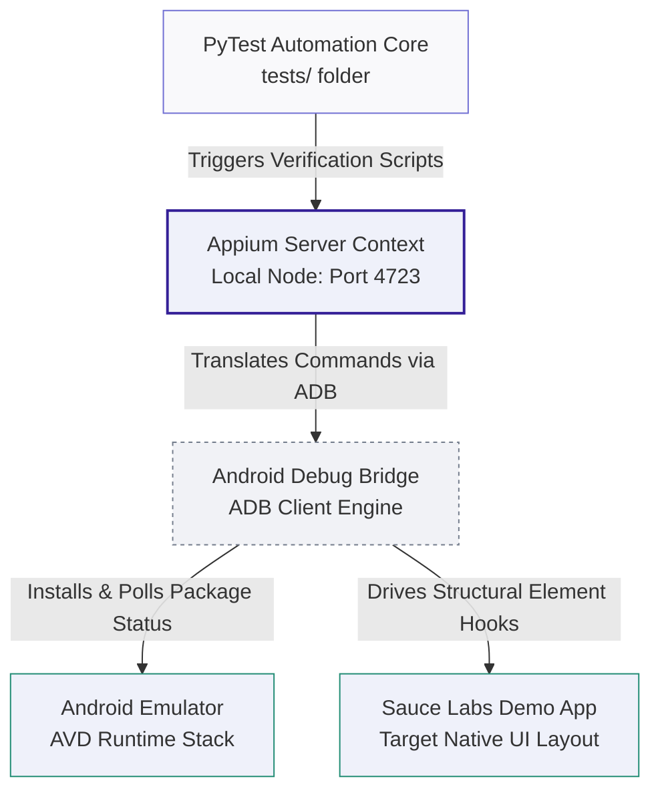

# 📱 Appium Mobile Test Automation — Sauce Labs Demo App

[](https://github.com)
[](https://appium.io)
[](https://pytest.org)

---

## 🎯 About The Project
This project serves as an enterprise-grade mobile automation playground and validation suite built using **Python**, **Appium**, and **PyTest**. It is specifically designed to isolate custom regression testing script modules, structural layout validations, and strict element tracking logic within native Android application ecosystems.

The architecture focuses on testing workflows against the Sauce Labs `"My Demo App RN"` native Android package, establishing clear processes for handling device capabilities, local app installations via Android Debug Bridge (ADB), explicit element waits, and clean execution logs.

### 🛠️ Technology Stack Breakdown
* **Mobile Driver Core:** Appium Client Library (Coordinates low-level automation gestures and matches locator contexts on devices)
* **Test Orchestration Engine:** PyTest Runner Framework (Manages assertion verification states, setup scripts, and output tables)
* **Hardware Bridge Tooling:** Android Debug Bridge - ADB (Manages background emulator socket configurations, device status polling, and package deployment pushes)
* **Virtualization Runtime:** Android Virtual Device - AVD (Emulates target mobile system architecture contexts headlessly or via visible screens)

---

## 🕹️ Interactive Navigation
* [🏗️ Sandbox Runtime Architecture](#-sandbox-runtime-architecture)
* [📋 Framework Component Matrix](#-framework-component-matrix)
* [📂 Directory Blueprint](#-directory-blueprint)
* [🚀 System Setup Walkthrough](#-system-setup-walkthrough)
* [🚦 Running Test Execution Matrix](#-running-test-execution-matrix)

---

## 🏗️ Sandbox Runtime Architecture



---

## 📋 Framework Component Matrix

| Component Layer | Runtime Context Target | Strategic Test Execution Objective |
| :--- | :--- | :--- |
| **PyTest Automation Core** | Local Environment Workspace | Orchestrates script execution timelines, parses tags, and handles structural assertions. |
| **Appium WebDriver Bridge** | Headless Listening Node (`localhost:4723`) | Translates automation script commands into structured mobile actions. |
| **Android Debug Bridge (ADB)** | System Workspace Path Shell | Monitors local emulator hardware connectivity, provisions files, and validates active device arrays. |
| **Sauce Labs Application** | Target Virtual Device Package | Serves as the functional testing sandbox to execute layout validations and tracking runs. |

---

## 📂 Directory Blueprint

```text
appium-demo-app-tests/
├── tests/                     # Sandbox Verification Execution Suite
│   ├── conftest.py            # Local device capabilities mapping and driver session hooks
│   ├── test_layouts.py        # Structural application view checking matrices
│   └── test_regression.py     # End-to-end regression validation script loops
├── .gitignore                 # Binary pattern filter (system logs, virtual environments, caches)
├── requirements.txt           # Explicit Python framework software dependency sheets
└── README.md                  # Comprehensive framework master technical blueprint
```

---

## 🚀 System Setup Walkthrough

Configure your workstation environment sequentially to initialize local testing execution cycles:

### 1. Step into the local project directory path
```bash
cd /Users/pallawigupta/Downloads/Github_projects/appium-demo-app-tests
```

### 2. Configure the isolated Python Virtual Environment
```bash
python3 -m venv venv
source venv/bin/activate
```

### 3. Deploy system framework runtime dependencies
```bash
pip install -r requirements.txt
```

### 4. Push the native app package directly onto your active virtual device
```bash
adb install path/to/app.apk
```

### 5. Start the underlying listener nodes
Open a separate terminal window and launch the main Appium broker process:
```bash
appium
```
Verify that your target Android Emulator is actively communicating with the workstation:
```bash
adb devices
```

---

## 🚦 Running Test Execution Matrix

Execute your automated validation sequences from the root project folder:

### 1. Run Complete Sandbox Regression Pipeline
```bash
pytest tests/ -v
```

### 2. Generate Detailed Telemetry Reports
```bash
# Execute suite and stream test tracing data out to log directories
pytest tests/ -v --alluredir=allure-results

# Compile logs and open interactive dashboard layout inside your browser
allure serve allure-results
```
